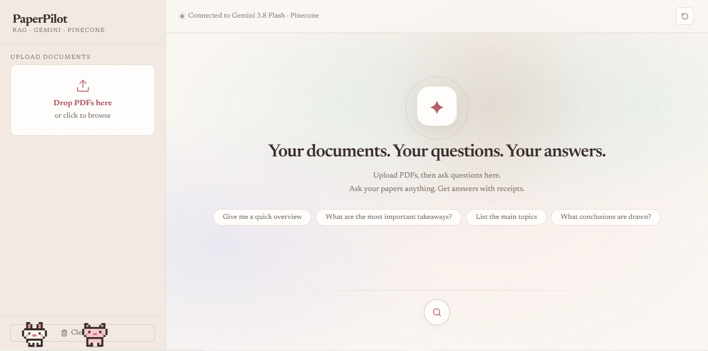

# PaperPilot

<div align="center">
  
</div>

**Ask your papers anything. Get answers you can verify.**

PaperPilot is a full-stack RAG (Retrieval-Augmented Generation) app. Upload PDFs, ask questions in plain language, and get answers grounded in your documents, with citations pointing to the file and page they came from.


## Features

- Drag-and-drop PDF upload with indexing progress
- Semantic search over your documents using Gemini embeddings and Pinecone
- Answers generated from retrieved passages only, with inline `[Source N]` references
- Collapsible source list showing file name, page number and a text snippet
- Follow-up questions (the last few turns of the conversation are sent along)
- Two ways to run it: a web UI, or a terminal chatbot (`chat.py`), both on the same RAG engine
- A couple of pixel pets wandering the bottom of the screen

## How it works

```
PDF -> pypdf (extract text per page)
    -> LangChain RecursiveCharacterTextSplitter (1000-char chunks, 150 overlap)
    -> Gemini embeddings (gemini-embedding-001, 3072 dimensions)
    -> Pinecone (vectors + file/page metadata)

Question -> embed -> Pinecone similarity search (top 5 chunks)
         -> Gemini LLM (question + retrieved chunks)
         -> answer + sources -> React UI
```

## Tech stack

**Frontend:** React 18, Vite, Axios, react-markdown, react-dropzone, Lucide icons, custom CSS

**Backend:** FastAPI, Uvicorn, LangChain, pypdf

**AI & search:** Google Gemini (embeddings + LLM), Pinecone (cosine similarity)

## Project structure

```
paperpilot/
├── backend/
│   ├── main.py            # FastAPI server (/health, /upload, /query)
│   ├── chat.py            # Terminal chatbot
│   ├── rag_engine.py      # Core RAG logic shared by both
│   ├── requirements.txt
│   └── .env.example
├── frontend/
│   ├── src/
│   │   ├── components/    # Sidebar.jsx, Message.jsx
│   │   ├── App.jsx
│   │   ├── PixelPets.jsx
│   │   ├── api.js
│   │   └── index.css
│   ├── index.html
│   └── package.json
├── assets/                # README screenshots
└── README.md
```

## Getting started

### Prerequisites

- **Python 3.11** (the pinned LangChain versions were tested on 3.11; newer versions may fail to install)
- Node.js 18+
- A [Gemini API key](https://aistudio.google.com/app/apikey)
- A [Pinecone API key](https://app.pinecone.io)

### 1. Configure environment variables

Create `backend/.env` from the template:

```bash
cd backend
cp .env.example .env        # Windows: copy .env.example .env
```

```
GEMINI_API_KEY=your_gemini_api_key
PINECONE_API_KEY=your_pinecone_api_key
PINECONE_INDEX_NAME=doc-chatbot
```

Never commit `.env`. It is listed in `.gitignore`.

### 2. Run the backend

```bash
cd backend
python3.11 -m venv venv              # Windows: py -3.11 -m venv venv
source venv/bin/activate             # Windows: venv\Scripts\Activate.ps1
pip install -r requirements.txt
uvicorn main:app --reload
```

Backend runs at http://localhost:8000

### 3. Run the frontend

In a second terminal:

```bash
cd frontend
npm install
npm run dev
```

Open http://localhost:5173

### Terminal mode (no browser)

```bash
cd backend
python chat.py
```

## Usage

1. Drop one or more PDFs into the sidebar.
2. Wait for the "chunks indexed" confirmation.
3. Ask a question and press **Enter**.
4. Expand **sources referenced** under an answer to check the original passages.

## API

| Method | Endpoint  | Description                          |
|--------|-----------|--------------------------------------|
| GET    | `/health` | Check the backend is running         |
| POST   | `/upload` | Upload and index a PDF               |
| POST   | `/query`  | Ask a question, returns answer + sources |


## Possible improvements

- Per-document filtering for queries
- Streaming responses
- Deleting documents from the index

